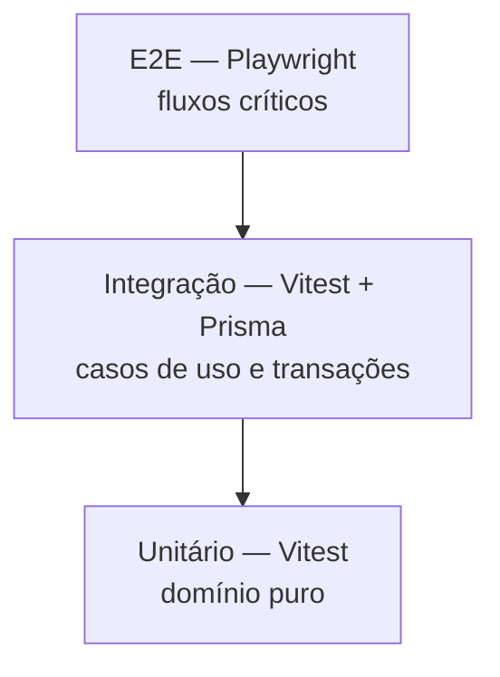
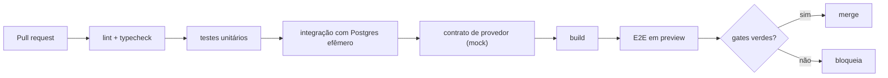

# Estratégia de Testes — Investment Control

> **Derivado de:** `REQUIREMENTS.md`, `quality/ACCEPTANCE_CRITERIA.md`, `specs/ARCHITECTURE.md`.
> **Princípio (ADR-010):** nenhuma task que altere cálculo financeiro é concluída sem teste automatizado.

---

## 1. Objetivo

Garantir que **posição, preço médio, patrimônio, alocação e projeção** estejam corretos e que nenhuma regra de negócio seja perdida entre requisito e código. O risco central não é a tela quebrar — é o número errado parecer certo.

---

## 2. Pirâmide e níveis

| Nível | Escopo | Ferramenta | Proporção alvo |
|---|---|---|---|
| Unitário de domínio | Funções puras: preço médio, desvio, pontuação, projeção, validações | Vitest | ~65% |
| Integração | Caso de uso + Prisma + banco real (Postgres efêmero ou branch do Neon) | Vitest + Prisma | ~20% |
| Contrato de provedor | Normalização de resposta de cada provedor contra fixture | Vitest + MSW | ~5% |
| End-to-end | Fluxo de usuário no navegador | Playwright | ~10% |
| Manual exploratório | Jornada completa e casos de borda visuais | Roteiro | antes de cada release |

---

## 3. Ferramentas e comandos

| Ferramenta | Uso | Comando |
|---|---|---|
| Vitest | Unitário e integração | `npm run test` |
| Testing Library | Componentes React | `npm run test -- --project=ui` |
| Playwright | E2E | `npm run test:e2e` |
| MSW | Mock de HTTP externo | embutido nos testes de contrato |
| Prisma | Banco de teste | `npm run db:test:reset` |
| ESLint + tsc | Análise estática | `npm run lint` · `npm run typecheck` |
| npm audit | Vulnerabilidades | `npm audit --audit-level=high` |

---

## 4. Cobertura e gates

| Escopo | Mínimo | Bloqueia merge |
|---|---|---|
| `src/modules/**` (linhas) | 90% | sim |
| `src/modules/**` (branches) | 85% | sim |
| `src/infra/**` | 70% | não (alerta) |
| `app/**` e `components/**` | 60% | não |
| Global | 75% | sim |

Regras adicionais:

- Regra financeira sem branch de erro testado conta como não coberta.
- Código gerado (Prisma client) e migrations ficam fora da métrica.
- Cobertura não substitui teste de caso real: os casos de ouro da §5 são obrigatórios mesmo com 100%.

---

## 5. Casos de ouro (obrigatórios)

| # | Cenário | Entrada | Resultado esperado |
|---|---|---|---|
| G1 | Preço médio com duas compras | 10 @ 100,00 + 10 @ 120,00 | preço médio 110,00; custo 2.200,00 |
| G2 | Venda mantém preço médio | G1 + venda de 5 cotas a 130,00 | quantidade 15; preço médio 110,00; custo 1.650,00; resultado realizado 100,00 |
| G3 | Nova compra após venda | G2 + compra de 5 @ 100,00 | preço médio recalculado sobre 20 cotas = 107,50 |
| G4 | Posição zerada | compra 10 e venda 10 | quantidade 0; preço médio 0; custo 0 |
| G5 | Venda acima da posição | posição 10, venda 15 | bloqueio com `MOV_POSICAO_NEGATIVA`, nada gravado |
| G6 | Total inconsistente | 10 × 100 + 3 = 1.003; informado 1.005 | erro de consistência, exige observação |
| G7 | Dividendos não afetam preço médio | compra 10 @ 100 + dividendo 50 | preço médio continua 100; rendimento separado |
| G8 | Alocação 50/50 | patrimônio 100.000 (40.000 RF / 60.000 FII) | RF 40% (−10 p.p.), FII 60% (+10 p.p.) |
| G9 | Priorização do aporte | desvio RF −10 p.p., FII +10 p.p., aporte 1.000 | 1.000 para RF; 0 para FII |
| G10 | Aporte que zera o desvio | desvio RF −R$ 1.000, aporte 2.000 | 1.000 RF + 1.000 distribuído conforme próxima prioridade |
| G11 | Soma de metas inválida | 60% + 30% | rejeição com soma 90 |
| G12 | Nota com dado ausente | 2 de 7 critérios sem dado | nota calculada apenas sobre os disponíveis; `dados_indisponiveis` preenchido; nunca 100 |
| G13 | Projeção real vs nominal | 300.000, 6% real, 4% inflação, 10 anos | nominal ≈ 300.000 × 1,10^10; real ≈ 300.000 × 1,06^10 |
| G14 | Arredondamento monetário | 0,1 + 0,2 | 0,30 exato (sem erro de ponto flutuante) |
| G15 | Percentual de segmento | FII 60.000, logística 15.000 | 25% do patrimônio de FIIs (ou do total, conforme `PEND-011`) |

> Os casos G1–G6 e G13–G14 devem ser escritos **antes** da implementação correspondente (TDD obrigatório para núcleo financeiro).

---

## 6. Dados de teste

| Conjunto | Conteúdo | Uso |
|---|---|---|
| `fixtures/carteira-vazia` | Usuário sem ativo | Estados vazios |
| `fixtures/carteira-basica` | 3 FIIs + 2 títulos RF | Carteira, dashboard, desvios |
| `fixtures/carteira-desbalanceada` | 20% RF / 80% FII | Priorização de aporte |
| `fixtures/historico-12m` | 12 meses de preço e dividendos | Gráficos e DY |
| `fixtures/provedor-*` | Respostas reais anonimizadas de cada provedor | Teste de contrato |
| `fixtures/avaliacao-incompleta` | FII sem vacância e sem PL | RN-042 |

Regras: nenhum dado real de titular em fixture; valores fictícios e determinísticos; datas fixas (`2026-01-01`) para evitar teste dependente de relógio.

---

## 7. Testes por fase

| Fase | Foco | Bloqueia release |
|---|---|---|
| Fase 1 | Posição, preço médio, carteira, renda fixa, metas, desvio, dashboard | Sim |
| Fase 2 | Aporte, priorização, checklist, concentração | Sim |
| Fase 3 | Contrato de provedores, cache, proveniência, degradação | Sim |
| Fase 4 | Pontuação, dado ausente, sustentabilidade | Sim |
| Fase 5 | Projeção nominal/real, cenários | Sim |

---

## 8. Matriz RN → tipo de teste

| Grupo de RN | Unitário | Integração | E2E | Manual |
|---|---|---|---|---|
| RN-014 a RN-019 (movimentação/posição) | ✅ G1–G7 | ✅ | ✅ | — |
| RN-020 a RN-024 (carteira/alocação) | ✅ G8, G11, G15 | ✅ | ✅ | — |
| RN-025 a RN-028 (aportes) | ✅ G9, G10 | ✅ | ✅ | — |
| RN-029 a RN-038 (integração) | ✅ normalização | ✅ cache/proveniência | — | ✅ provedor real |
| RN-039 a RN-048 (avaliação) | ✅ G12 | ✅ | ✅ | ✅ |
| RN-049 a RN-056 (risco/decisão) | ✅ | ✅ | ✅ | — |
| RN-057 a RN-060 (renda fixa) | ✅ | ✅ | ✅ | — |
| RN-061 a RN-063 (dashboard) | — | ✅ | ✅ | ✅ visual |
| RN-064 a RN-066 (projeções) | ✅ G13 | ✅ | ✅ | — |
| RN-067 a RN-074 (segurança) | ✅ | ✅ IDOR/rate limit | ✅ | — |
| RN-085 a RN-088 (conta) | ✅ token | ✅ | ✅ | ✅ e-mail real |

---

## 9. Pipeline

| Gate | Bloqueia |
|---|---|
| Lint e typecheck | sim |
| Unitário de domínio | sim |
| Cobertura mínima | sim |
| Integração | sim |
| Contrato de provedor | sim (Fase 3+) |
| E2E de fluxo crítico (login, movimentação, carteira) | sim |
| `npm audit --audit-level=high` | sim |

---

## 10. Lacunas e riscos conhecidos

| # | Lacuna | Mitigação |
|---|---|---|
| T1 | E-mail transacional não é testável localmente sem provedor | Usar MailHog/Ethereal em desenvolvimento |
| T2 | Dados reais de provedor podem divergir do fixture | Teste manual trimestral contra o provedor ativo |
| T3 | Projeção depende de premissas (`PEND-010`) | Testar a fórmula, não o valor absoluto |
| T4 | Cálculo de FGC depende de regra externa (`PEND-012`) | Isolar em função configurável |
| T5 | Banco Neon branch pode ter latência | Teste de integração usa Postgres local em CI |
