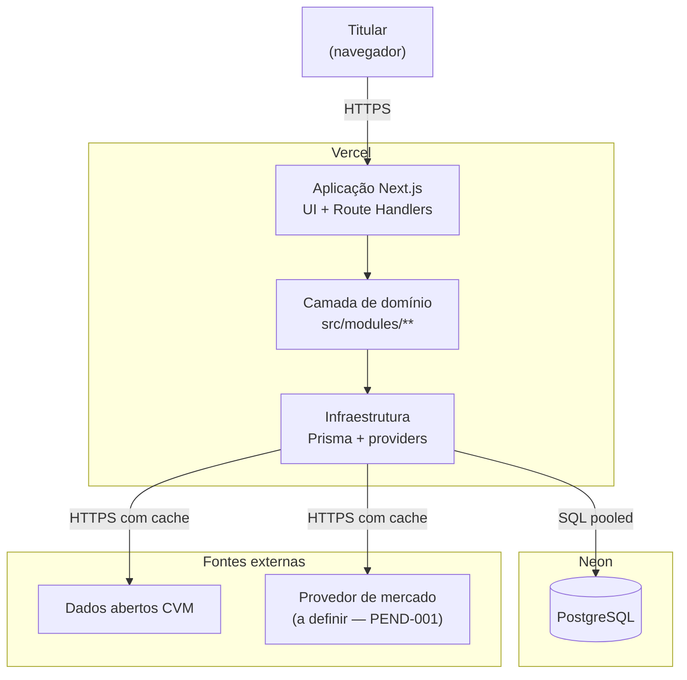
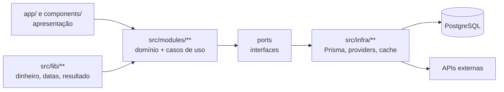
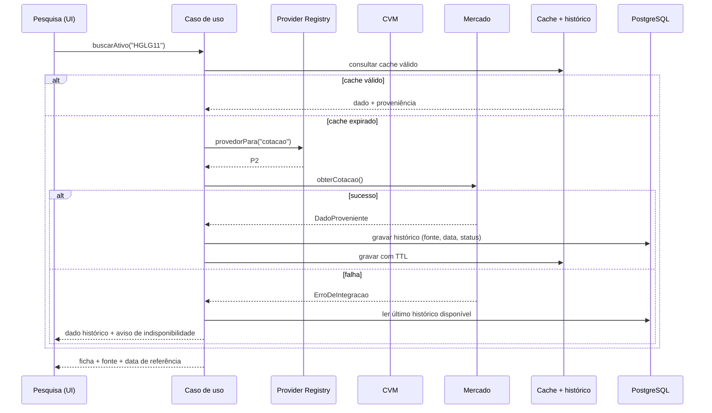
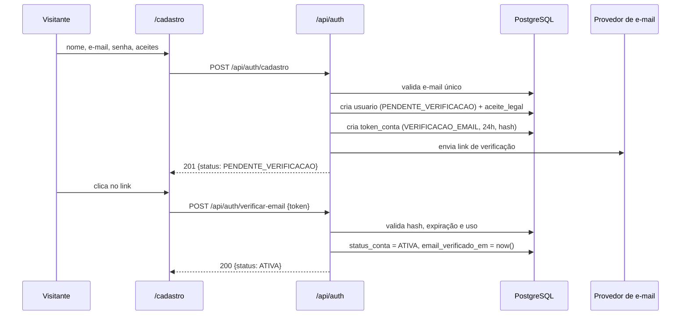
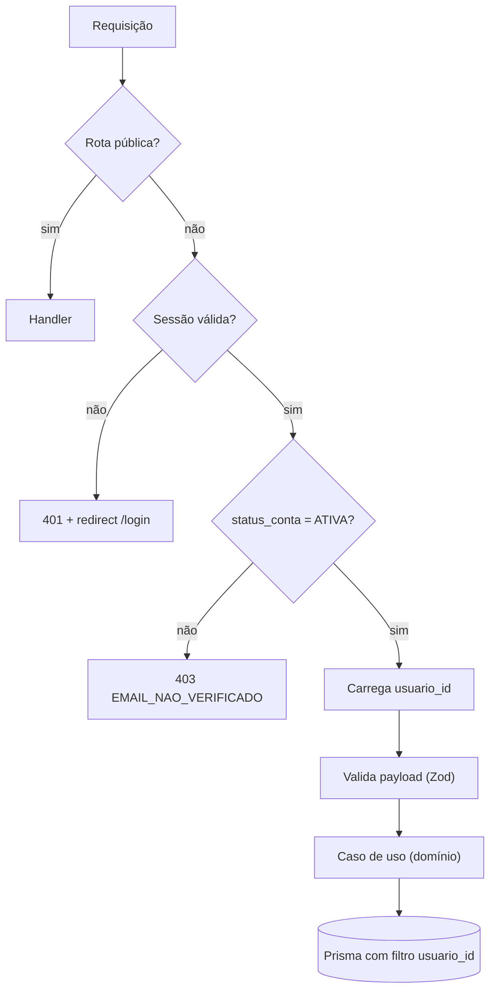
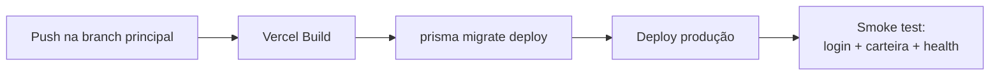

# Arquitetura — Investment Control

> **Derivado de:** `PROJECT_CHARTER.md` e `REQUIREMENTS.md` (RN-001 a RN-084).
> **Decisões relacionadas:** ADR-001 a ADR-010 em `DECISIONS.md`.

---

## 1. Contexto e objetivos arquiteturais

O sistema é uma aplicação web pessoal que consolida patrimônio em FIIs e renda fixa, compara a carteira com metas configuráveis e apoia a decisão de aporte. Ele **não** executa ordens e **não** recomenda compra automaticamente.

Objetivos que moldam a arquitetura:

| # | Objetivo | Consequência arquitetural |
|---|---|---|
| O1 | Nenhum dado financeiro sem fonte e data de referência | Proveniência obrigatória em toda série de mercado |
| O2 | Troca de provedor sem alterar regra de negócio | Camada de provedores com contrato por capacidade |
| O3 | Cálculo financeiro confiável | Domínio isolado de framework, decimal, testes obrigatórios |
| O4 | Metas, pesos e limites configuráveis sem deploy | Configuração em banco com vigência |
| O5 | Continuidade quando a fonte externa cai | Cache local + leitura de dados históricos |
| O6 | Custo operacional próximo de zero | Monolito modular, um deploy, banco serverless |
| O7 | Dado pessoal e patrimonial protegido | Autenticação, isolamento por usuário, segredos fora do código |

---

## 2. Visão de containers (C4 nível 2)



Regras:

- O navegador **nunca** fala com CVM ou provedor de mercado.
- Toda chamada externa passa por `src/infra/providers/**`.
- Nenhum componente React importa `src/infra/**` diretamente.

---

## 3. Camadas e regras de dependência



| Camada | Pode importar | Proibido importar |
|---|---|---|
| `app/`, `components/` | `src/modules/**` (casos de uso e tipos), `src/lib/**` | `src/infra/**`, `@prisma/client` |
| `src/modules/**` | `src/lib/**`, tipos de `src/modules/**` | `next/*`, `@prisma/client`, SDK de provedor |
| `src/infra/**` | `@prisma/client`, SDKs, `src/modules/**` (tipos e ports) | `next/*` de UI, `components/**` |
| `src/lib/**` | bibliotecas puras (decimal, date) | qualquer camada acima |

**Ports** (interfaces) vivem no módulo de domínio e são implementados na infraestrutura — inversão de dependência explícita (ADR-004).

---

## 4. Mapa de módulos

```
src/
├── app/                          # rotas Next.js
│   ├── (public)/
│   │   ├── login/
│   │   ├── cadastro/
│   │   ├── verificar-email/
│   │   ├── esqueci-senha/
│   │   └── redefinir-senha/
│   ├── (private)/
│   │   ├── dashboard/
│   │   ├── carteira/
│   │   ├── ativos/[ticker]/
│   │   ├── movimentacoes/
│   │   ├── renda-fixa/
│   │   ├── pesquisa/
│   │   ├── alocacao/
│   │   ├── aportes/
│   │   ├── projecoes/
│   │   └── configuracoes/
│   └── api/
│       ├── auth/[...nextauth]/
│       ├── ativos/
│       ├── movimentacoes/
│       ├── carteira/
│       ├── renda-fixa/
│       ├── alocacao/
│       ├── aportes/
│       ├── pesquisa/
│       ├── avaliacoes/
│       ├── watchlist/
│       └── projecoes/
├── modules/
│   ├── ativos/                   # cadastro, classes e segmentos
│   ├── movimentacoes/            # registro e validação de consistência
│   ├── posicao/                  # cálculo de posição, preço médio, custo
│   ├── rendimentos/              # proventos e competência
│   ├── renda-fixa/               # títulos, saldo, FGC, vencimentos
│   ├── carteira/                 # consolidação e patrimônio
│   ├── alocacao/                 # metas, percentuais, desvios
│   ├── aportes/                  # sugestão e simulador
│   ├── avaliacao/                # critérios, pesos, nota, sustentabilidade
│   ├── risco/                    # concentração e alertas
│   ├── projecoes/                # patrimônio e renda futura
│   └── pesquisa/                 # orquestração de provedores + cache
├── infra/
│   ├── db/                       # Prisma client e repositórios
│   ├── providers/
│   │   ├── cvm/
│   │   ├── mercado/
│   │   ├── renda-fixa/
│   │   └── registry.ts
│   ├── cache/
│   └── auth/
└── lib/
    ├── decimal.ts
    ├── money.ts
    ├── date.ts
    └── result.ts
```

---

## 5. Camada de provedores

### 5.1 Contrato

```ts
type Capacidade =
  | 'cadastro'        // dados cadastrais do fundo
  | 'cotacao'         // último fechamento
  | 'historico-preco'
  | 'dividendos'
  | 'indicadores'     // DY, P/VP, PL, VPC
  | 'informes'        // CVM: mensal/trimestral
  | 'composicao'      // ativos e passivos
  | 'renda-fixa';

interface ProvedorDados {
  readonly nome: string;
  readonly capacidades: ReadonlySet<Capacidade>;
  suporta(c: Capacidade): boolean;
  // Cada método devolve DadoProveniente<T> ou LançaErroDeIntegracao
  obterCotacao(ticker: string): Promise<DadoProveniente<Cotacao>>;
  // ...demais operações opcionais
}

interface DadoProveniente<T> {
  valor: T;
  fonte: string;
  provedorId: string;
  dataReferencia: string;   // ISO date
  coletadoEm: string;       // ISO datetime
  statusDado: 'OFICIAL' | 'MERCADO' | 'ESTIMADO' | 'HISTORICO' | 'INDISPONIVEL';
}
```

### 5.2 Resolução por capacidade



### 5.3 Regras

- Provedor sem a capacidade → `OPERACAO_NAO_SUPORTADA`, nunca valor zero.
- Falha → grava em `log_integracao` (sem segredo) e degrada para dado armazenado (RN-073).
- Precedência de provedor por operação é configuração (`provedor_dados.prioridade`), não código.
- Normalização de nomes de campo acontece **dentro** do provedor; o domínio só vê o tipo normalizado.

---

## 6. API interna

Convenções:

| Aspecto | Regra |
|---|---|
| Base | `/api` |
| Formato | JSON; valores monetários serializados como **string decimal** |
| Autenticação | Sessão (cookie `httpOnly`); 401 sem sessão |
| Validação | Zod na borda; erro 422 com `errors[]` por campo |
| Erro | Envelope `{ error: { code, message, details? } }` — catálogo em `ERROR_CATALOG.md` |
| Idempotência | Criação de movimentação aceita `Idempotency-Key` |
| Paginação | `?page=&pageSize=` com `meta.total` |
| Ordenação | `?sort=campo&order=asc|desc` com allowlist por recurso |
| Autorização | Toda query/escrita filtrada por `usuario_id` na camada de repositório |

Recursos previstos (Fase 1 em negrito):

- **`POST/GET /api/ativos`**, `GET /api/ativos/:ticker`
- **`POST/GET/PATCH /api/movimentacoes`**
- **`GET /api/carteira`**, **`GET /api/carteira/evolucao`**
- **`POST/GET/PATCH /api/renda-fixa`**
- **`GET/PUT /api/alocacao/metas`**, **`GET /api/alocacao/desvios`**
- `POST /api/aportes/sugestao`, `POST /api/aportes/simulacao`
- `GET /api/pesquisa?q=`
- `POST/GET /api/avaliacoes`, `GET /api/watchlist`
- `POST /api/projecoes`

Contratos detalhados em `specs/API_CONTRACTS.md` (a gerar).

---

## 7. Autenticação e sessão

Cadastro aberto com verificação de e-mail (ADR-011, RN-085 a RN-088).

- Auth.js com provider de credenciais (ADR-003).
- Senha: Argon2id, salt por usuário; verificação em tempo constante. Mínimo de 10 caracteres com checagem contra senhas vazadas conhecidas.
- Sessão: JWT em cookie `httpOnly`, `secure` em produção, `sameSite=lax`, expiração de 8 h com renovação por atividade.
- Middleware protege `(private)` e `/api/**` (exceto `/api/auth/*` e `/api/health`).
- Rate limit: login 5/15 min por IP + e-mail; emissão de token 3/h por e-mail; verificação 10/h por IP.
- Respostas neutras em "esqueci a senha" e "reenviar verificação" — nunca revelam existência do e-mail (RN-086).
- E-mail transacional via provedor de e-mail (SMTP/API); token aleatório de 32 bytes, armazenado apenas como hash.





---

## 8. Persistência

- PostgreSQL no Neon; Prisma como ORM e migrator.
- Duas URLs: `DATABASE_URL` (pooled, runtime) e `DIRECT_URL` (migrations).
- Prisma fora do domínio: repositórios em `src/infra/db` implementam ports.
- `prisma migrate dev` em desenvolvimento; `prisma migrate deploy` no pipeline de produção.
- Transações obrigatórias em: registrar movimentação + recalcular posição; gravar sugestão + ativos avaliados.
- Soft delete apenas onde a regra exige histórico (`movimentacao` não é excluída; correção gera estorno).

Detalhes de schema em `specs/DATA_MODEL.md`.

---

## 9. Configuração e segredos

| Variável | Uso | Ambiente |
|---|---|---|
| `DATABASE_URL` | Conexão pooled | todos |
| `DIRECT_URL` | Conexão direta para migrations | CI/local |
| `AUTH_SECRET` | Assinatura de sessão | todos |
| `EMAIL_SERVER` / `EMAIL_FROM` | Envio de verificação de e-mail e redefinição | todos |
| `PROVIDER_MERCADO_API_KEY` | Chave do provedor de mercado | produção/preview |
| `PROVIDER_CVM_BASE_URL` | Endpoint CVM | todos |

Regras:

- Nenhum `.env` versionado; apenas `.env.example` sem valores reais (RN-068).
- Segredos na Vercel por ambiente (Production/Preview/Development).
- Chave de provedor nunca chega ao bundle do cliente — só é lida em código de servidor.
- Rotação de chave documentada em `docs/howto/rotacao-de-chaves.md` (a criar).

---

## 10. Deploy



- Ambientes: Development (local), Preview (branch), Production (main).
- Build falha se `prisma validate` ou `tsc --noEmit` falhar.
- Migrations destrutivas exigem aprovação manual e backup prévio (`PEND-003`).
- Healthcheck: `GET /api/health` — verifica processo e conexão com o banco; não expõe versão de dependência.

---

## 11. Observabilidade e erros

| Sinal | Onde | Conteúdo |
|---|---|---|
| Log de integração | `log_integracao` | provedor, operação, status, duração, data de referência |
| Erro de aplicação | logs da Vercel | stack mascarada; sem payload financeiro completo |
| Erro de domínio | `Result<T, E>` | código tipado; mapeado para HTTP na borda |
| Métrica de saúde | `/api/health` | banco acessível, última importação CVM |

Princípios:

- Erro de provedor nunca derruba a tela inteira (RN-072, RN-073).
- Mensagem ao usuário não expõe detalhe interno, token ou URL com credencial.
- Toda inconsistência entre fontes gera registro consultável (RN-074).

---

## 12. Trade-offs assumidos

| Decisão | Ganho | Custo |
|---|---|---|
| Monolito modular em Next.js | Simplicidade de deploy e tipos compartilhados | Acoplamento ao runtime da Vercel |
| Domínio isolado com ports | Testabilidade e troca de provedor | Mais arquivos e mapeamentos |
| Prisma | Produtividade e schema tipado | Menos controle em queries analíticas complexas |
| Cache com TTL | Menos chamadas externas e custo | Dado pode estar defasado — mitigado pela proveniência |
| Configuração em banco | Mudança sem deploy | Necessidade de tela de administração e validação |
| Sem tempo real | Escopo e custo controlados | Carteira reflete o último fechamento, não o intraday |

---

## 13. Riscos arquiteturais

| # | Risco | Mitigação |
|---|---|---|
| A1 | Domínio importar Prisma por conveniência | Regra de lint de dependência (`no-restricted-imports`) no CI |
| A2 | Provedor mudar contrato sem aviso | Teste de contrato por provedor + versionamento de normalizador |
| A3 | Cálculo de posição divergir do extrato | Testes de ouro com casos reais anonimizados |
| A4 | Migração quebrar produção | `migrate deploy` idempotente, backup e revisão de SQL |
| A5 | Consultas N+1 na carteira | Repositório de carteira com query única + índices |
| A6 | Estouro de limite do provedor | Cache, backoff exponencial e fila de importação |
