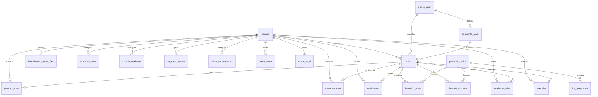

# Modelo de Dados — Investment Control

> **Derivado de:** `REQUIREMENTS.md` §6 e §9, `specs/ARCHITECTURE.md` §8.
> **Banco:** PostgreSQL 16 (Neon) · **ORM:** Prisma (ADR-002).

---

## 1. Visão geral

---

## 2. Convenções

| Item | Convenção |
|---|---|
| Nomenclatura | `snake_case`, tabelas no plural quando coleção (`ativo` no singular por ser entidade) |
| Chave primária | `id uuid` gerada pela aplicação (`crypto.randomUUID()`) — evita dependência de extensão |
| Chaves estrangeiras | `*_id uuid` com `ON DELETE RESTRICT` por padrão |
| Timestamps | `timestamptz` em UTC; `criado_em` default `now()`, `atualizado_em` por trigger de aplicação |
| Datas de negócio | `date` (sem timezone) — competência, vencimento, data de referência |
| Dinheiro | `numeric(18,2)` |
| Preço / indicador | `numeric(18,6)` |
| Quantidade de cota | `numeric(18,8)` |
| Percentual / taxa | `numeric(9,6)` (ex.: 12.500000 = 12,5%) |
| Nota | `numeric(5,2)` (0–100) |
| Booleano | `boolean` com default explícito |
| Dados flexíveis | `jsonb` somente para snapshots e parâmetros de regra — nunca para dado consultável por filtro |
| Exclusão | Física apenas em rascunho; fatos financeiros usam cancelamento lógico |

> **Regra de isolamento (RN-070):** todas as tabelas com dado do titular carregam `usuario_id` e têm índice iniciando por ele. Nenhuma consulta de repositório pode omitir esse filtro.

---

## 3. Enums

| Enum | Valores |
|---|---|
| `status_ativo` | `ATIVO`, `INATIVO`, `EM_ANALISE` |
| `tipo_movimentacao` | `COMPRA`, `VENDA`, `DIVIDENDO`, `JUROS`, `APLICACAO_RF`, `RESGATE_RF`, `TAXA` |
| `tipo_rendimento` | `DIVIDENDO`, `JURO`, `AMORTIZACAO` |
| `origem_dado` | `MANUAL`, `PROVEDOR`, `IMPORTACAO_CVM` |
| `status_dado` | `OFICIAL`, `MERCADO`, `ESTIMADO`, `HISTORICO`, `INDISPONIVEL` |
| `produto_renda_fixa` | `TESOURO_SELIC`, `TESOURO_IPCA`, `TESOURO_PREFIXADO`, `CDB`, `LCI`, `LCA`, `DEBENTURE`, `OUTRO` |
| `indexador_renda_fixa` | `PRE`, `POS_CDI`, `IPCA`, `SELIC`, `OUTRO` |
| `liquidez_renda_fixa` | `DIARIA`, `NO_VENCIMENTO`, `PRAZO` |
| `status_saldo` | `INFORMADO`, `ESTIMADO`, `CONFIRMADO` |
| `escopo_meta` | `CLASSE`, `SEGMENTO` |
| `status_watchlist` | `ESTUDAR`, `ACOMPANHAR`, `APROVADO`, `DESCARTADO` |
| `decisao_usuario` | `ACEITA`, `IGNORADA`, `ALTERADA` |
| `autenticacao_provedor` | `NENHUMA`, `API_KEY`, `OAUTH` |
| `status_integracao` | `SUCESSO`, `ERRO`, `TIMEOUT`, `LIMITE`, `DADOS_INCOMPLETOS` |
| `dimensao_concentracao` | `ATIVO`, `GESTORA`, `SEGMENTO`, `EMISSOR`, `IMOVEL` |
| `status_conta` | `PENDENTE_VERIFICACAO`, `ATIVA`, `SUSPENSA`, `EXCLUIDA` |
| `tipo_token_conta` | `VERIFICACAO_EMAIL`, `REDEFINICAO_SENHA` |
| `tipo_aceite_legal` | `TERMOS_USO`, `POLITICA_PRIVACIDADE` |
| `indicador_chave` | `PRECO`, `PVP`, `DY_12M`, `PL`, `VPC`, `COTISTAS`, `TAXA_ADM`, `TAXA_GESTAO`, `VACANCIA_FISICA`, `VACANCIA_FINANCEIRA`, `ALAVANCAGEM` |

---

## 4. Tabelas

### 4.1 `usuario`

| Coluna | Tipo | Restrições | Descrição |
|---|---|---|---|
| `id` | uuid | PK | — |
| `nome` | varchar(120) | NOT NULL | — |
| `email` | varchar(160) | NOT NULL, UNIQUE | Normalizado em minúsculas |
| `senha_hash` | text | NOT NULL | Argon2id; nunca serializado |
| `status_conta` | `status_conta` | NOT NULL, default `PENDENTE_VERIFICACAO` | `PENDENTE_VERIFICACAO`, `ATIVA`, `SUSPENSA`, `EXCLUIDA` |
| `email_verificado_em` | timestamptz | NULL | Preenchido na verificação (RN-085) |
| `criado_em` | timestamptz | NOT NULL, default now() | — |
| `atualizado_em` | timestamptz | NOT NULL | — |
| `ultimo_login_em` | timestamptz | NULL | — |
| `excluido_em` | timestamptz | NULL | Exclusão de conta (LGPD, direito do titular) |

**Índices:** `ux_usuario_email` (unique em `lower(email)`).

### 4.2 `classe_ativo`

| Coluna | Tipo | Restrições | Descrição |
|---|---|---|---|
| `id` | uuid | PK | — |
| `codigo` | varchar(30) | NOT NULL, UNIQUE | `RENDA_FIXA`, `FII` |
| `nome` | varchar(60) | NOT NULL | Rótulo exibido |
| `ativo` | boolean | NOT NULL, default true | Impede uso em novos cadastros |
| `ordem` | smallint | NOT NULL, default 0 | Ordenação na UI |

### 4.3 `segmento_ativo`

| Coluna | Tipo | Restrições | Descrição |
|---|---|---|---|
| `id` | uuid | PK | — |
| `classe_id` | uuid | NOT NULL, FK → `classe_ativo` | Segmento pertence a uma classe |
| `codigo` | varchar(40) | NOT NULL | `LOGISTICA`, `SHOPPING`, `RECEBIVEIS`, `LAJES`, `RENDA_URBANA`, `HIBRIDO`, `AGRO`, `OUTROS`, `CAIXA_OPORTUNIDADES` |
| `nome` | varchar(80) | NOT NULL | — |
| `ativo` | boolean | NOT NULL, default true | — |
| `ordem` | smallint | NOT NULL, default 0 | — |

**Índices:** `ux_segmento_classe_codigo` (unique `classe_id`, `codigo`).

### 4.4 `ativo`

| Coluna | Tipo | Restrições | Descrição |
|---|---|---|---|
| `id` | uuid | PK | — |
| `usuario_id` | uuid | NOT NULL, FK → `usuario` | Isolamento |
| `ticker` | varchar(20) | NOT NULL | Maiúsculas, sem espaço |
| `nome` | varchar(160) | NOT NULL | — |
| `classe_id` | uuid | NOT NULL, FK → `classe_ativo` | — |
| `segmento_id` | uuid | NULL, FK → `segmento_ativo` | Obrigatório quando classe = FII (CHECK) |
| `cnpj` | varchar(14) | NULL | Somente dígitos; validar DV |
| `administrador` | varchar(160) | NULL | — |
| `gestor` | varchar(160) | NULL | — |
| `status` | `status_ativo` | NOT NULL, default `ATIVO` | — |
| `fonte_dados` | varchar(60) | NULL | Nome do provedor |
| `observacoes` | text | NULL | — |
| `criado_em` | timestamptz | NOT NULL | — |
| `atualizado_em` | timestamptz | NOT NULL | — |

**Índices:** `ux_ativo_usuario_ticker` (unique), `ix_ativo_usuario_status`, `ix_ativo_segmento`.
**Checks:** `chk_ativo_ticker_formato` (`ticker ~ '^[A-Z0-9]{4,20}$'`); `chk_ativo_segmento_fii` (quando a classe for FII, `segmento_id IS NOT NULL`) — implementado em caso de uso + constraint trigger, pois depende de outra tabela.

### 4.5 `movimentacao`

| Coluna | Tipo | Restrições | Descrição |
|---|---|---|---|
| `id` | uuid | PK | — |
| `usuario_id` | uuid | NOT NULL, FK → `usuario` | — |
| `ativo_id` | uuid | NOT NULL, FK → `ativo` | — |
| `tipo` | `tipo_movimentacao` | NOT NULL | — |
| `data` | date | NOT NULL, `<= current_date + 1` | Data do fato |
| `quantidade` | numeric(18,8) | NULL | Obrigatório em COMPRA/VENDA |
| `valor_unitario` | numeric(18,2) | NULL | Obrigatório em COMPRA/VENDA |
| `valor_total` | numeric(18,2) | NOT NULL, `> 0` | Validado contra quantidade × unitário + custos (RN-019) |
| `custos` | numeric(18,2) | NOT NULL, default 0, `>= 0` | — |
| `observacoes` | text | NULL | Obrigatório quando diferença > R$ 0,01 |
| `cancelada_em` | timestamptz | NULL | Estorno lógico; nunca delete físico |
| `cancelamento_motivo` | text | NULL | Obrigatório se `cancelada_em` |
| `idempotency_key` | varchar(64) | NULL | Unique por usuário |
| `criado_em` | timestamptz | NOT NULL | — |

**Índices:** `ix_mov_usuario_data` (`usuario_id`, `data` DESC), `ix_mov_ativo_data` (`ativo_id`, `data`), `ux_mov_idempotency` (unique `usuario_id`, `idempotency_key`) parcial.
**Checks:** `chk_mov_qtd_positiva`, `chk_mov_valor_positivo`, `chk_mov_qtd_obrigatoria` (tipo em COMPRA/VENDA exige `quantidade` e `valor_unitario` não nulos).

### 4.6 `posicao_ativo`

| Coluna | Tipo | Restrições | Descrição |
|---|---|---|---|
| `usuario_id` | uuid | PK (composta), FK | — |
| `ativo_id` | uuid | PK (composta), FK | — |
| `quantidade` | numeric(18,8) | NOT NULL, `>= 0` | Derivada |
| `preco_medio` | numeric(18,6) | NOT NULL, `>= 0` | Derivado |
| `custo_total` | numeric(18,2) | NOT NULL, `>= 0` | `quantidade × preco_medio` |
| `ultima_movimentacao_id` | uuid | NULL, FK | Rastreio do recálculo |
| `atualizado_em` | timestamptz | NOT NULL | — |

> **Regra:** `posicao_ativo` é tabela derivada (cache de leitura). Pode ser reconstruída integralmente a partir de `movimentacao`. Nunca é fonte primária (RN-015).

> **Exceção de posição negativa (RN-018):** uma venda confirmada acima da posição é registrada e auditada, mas o cache não pode armazenar quantidade negativa (CHECK `>= 0`). Nesse caso a linha de cache é removida e a posição derivada passa a ser calculada do razão (podendo ser negativa) até que uma nova entrada a torne não negativa.

### 4.7 `rendimento`

| Coluna | Tipo | Restrições | Descrição |
|---|---|---|---|
| `id` | uuid | PK | — |
| `usuario_id` | uuid | NOT NULL, FK | — |
| `ativo_id` | uuid | NOT NULL, FK | — |
| `tipo` | `tipo_rendimento` | NOT NULL | — |
| `data_pagamento` | date | NOT NULL | — |
| `competencia` | char(7) | NULL | `YYYY-MM` |
| `valor` | numeric(18,2) | NOT NULL, `> 0` | — |
| `origem` | `origem_dado` | NOT NULL | — |
| `movimentacao_id` | uuid | NULL, FK → `movimentacao` | Quando lançado como movimentação de dividendo |
| `criado_em` | timestamptz | NOT NULL | — |

**Índices:** `ix_rend_usuario_data` (`usuario_id`, `data_pagamento`), `ix_rend_ativo_competencia`.
**Regra:** rendimento não compõe preço médio (RN-017).

### 4.8 `investimento_renda_fixa`

| Coluna | Tipo | Restrições | Descrição |
|---|---|---|---|
| `id` | uuid | PK | — |
| `usuario_id` | uuid | NOT NULL, FK | — |
| `instituicao` | varchar(120) | NOT NULL | — |
| `produto` | `produto_renda_fixa` | NOT NULL | — |
| `indexador` | `indexador_renda_fixa` | NOT NULL | — |
| `taxa` | numeric(9,6) | NOT NULL, `>= 0` | % ao ano (12.5 = 12,5%) |
| `data_aplicacao` | date | NOT NULL | — |
| `vencimento` | date | NULL, `> data_aplicacao` | — |
| `valor_aplicado` | numeric(18,2) | NOT NULL, `> 0` | — |
| `saldo_atual` | numeric(18,2) | NOT NULL, `>= 0` | — |
| `status_saldo` | `status_saldo` | NOT NULL, default `INFORMADO` | — |
| `liquidez` | `liquidez_renda_fixa` | NOT NULL | — |
| `carencia_ate` | date | NULL | — |
| `cobertura_fgc` | boolean | NOT NULL, default false | Calculado por produto |
| `observacoes` | text | NULL | — |
| `criado_em` | timestamptz | NOT NULL | — |
| `atualizado_em` | timestamptz | NOT NULL | — |

**Índices:** `ix_rf_usuario_vencimento`, `ix_rf_usuario_instituicao`.

> **Sem histórico de saldo na Fase 1:** `saldo_atual` é sobrescrito a cada atualização manual (RN-059). A evolução da carteira (`GET /api/carteira/evolucao`) usa o saldo atual como constante; o histórico de saldo entra quando existir a rotina de atualização automática (RN-053/RN-060).

### 4.9 `alocacao_meta`

| Coluna | Tipo | Restrições | Descrição |
|---|---|---|---|
| `id` | uuid | PK | — |
| `usuario_id` | uuid | NOT NULL, FK | — |
| `escopo` | `escopo_meta` | NOT NULL | — |
| `classe_id` | uuid | NULL, FK | Obrigatório se escopo = CLASSE |
| `segmento_id` | uuid | NULL, FK | Obrigatório se escopo = SEGMENTO |
| `percentual` | numeric(9,6) | NOT NULL, `>= 0 AND <= 100` | — |
| `vigencia_inicio` | date | NOT NULL | — |
| `vigencia_fim` | date | NULL, `>= vigencia_inicio` | Nulo = vigente |
| `criado_em` | timestamptz | NOT NULL | — |

**Checks:** `chk_meta_referencia` (exatamente um entre `classe_id` e `segmento_id`, coerente com `escopo`); `chk_meta_percentual`; `chk_meta_vigencia`.
**Vigência:** índices únicos parciais garantem **uma única linha vigente por referência** — `ux_meta_vigente_classe` em `(usuario_id, classe_id)` e `ux_meta_vigente_segmento` em `(usuario_id, segmento_id)`, ambos `WHERE vigencia_fim IS NULL`. Uma substituição encerra a vigência anterior e insere o novo conjunto na mesma transação.
**Validação de soma 100%:** na camada de domínio, dentro de transação — não é constraint de linha (RN-021, RN-022).

### 4.10 `criterio_avaliacao`

| Coluna | Tipo | Restrições | Descrição |
|---|---|---|---|
| `id` | uuid | PK | — |
| `usuario_id` | uuid | NOT NULL, FK | — |
| `codigo` | varchar(40) | NOT NULL | `QUALIDADE_ATIVOS`, `DIVERSIFICACAO`, `SAUDE_FINANCEIRA`, `HISTORICO_GESTAO`, `SEGMENTO_RESILIENCIA`, `PRECO_VALUATION`, `RENDIMENTOS_SUSTENTABILIDADE` |
| `nome` | varchar(120) | NOT NULL | — |
| `peso` | smallint | NOT NULL, `>= 0 AND <= 100` | Soma 100 por configuração vigente |
| `regra` | jsonb | NOT NULL | Parâmetros (ex.: `{"pl_min":1000000000,"anos_min":5}`) |
| `vigencia_inicio` | date | NOT NULL | — |
| `vigencia_fim` | date | NULL | — |
| `ativo` | boolean | NOT NULL, default true | — |

**Índices:** `ux_criterio_usuario_codigo_vigencia`.

### 4.11 `avaliacao_ativo`

| Coluna | Tipo | Restrições | Descrição |
|---|---|---|---|
| `id` | uuid | PK | — |
| `usuario_id` | uuid | NOT NULL, FK | — |
| `ativo_id` | uuid | NOT NULL, FK | — |
| `nota` | numeric(5,2) | NULL, `>= 0 AND <= 100` | Nula quando dados insuficientes (RN-042) |
| `criterios_atendidos` | jsonb | NOT NULL, default `[]` | `[{codigo, evidencia, fonte, data_referencia}]` |
| `criterios_nao_atendidos` | jsonb | NOT NULL, default `[]` | `[{codigo, motivo}]` |
| `dados_indisponiveis` | jsonb | NOT NULL, default `[]` | `[{codigo, campo}]` |
| `justificativa` | text | NOT NULL | — |
| `configuracao_snapshot` | jsonb | NOT NULL | Critérios e pesos usados |
| `data_analise` | timestamptz | NOT NULL | — |

**Índices:** `ix_aval_usuario_ativo_data` (`usuario_id`, `ativo_id`, `data_analise` DESC).

### 4.12 `historico_preco`

| Coluna | Tipo | Restrições | Descrição |
|---|---|---|---|
| `id` | uuid | PK | — |
| `ativo_id` | uuid | NOT NULL, FK | — |
| `data_referencia` | date | NOT NULL | Dia do preço |
| `valor` | numeric(18,6) | NOT NULL, `>= 0` | Último fechamento |
| `fonte` | varchar(60) | NOT NULL | Ex.: `brapi`, `b3` |
| `provedor_id` | uuid | NULL, FK → `provedor_dados` | — |
| `status_dado` | `status_dado` | NOT NULL | `MERCADO` na coleta; `HISTORICO` em carga retroativa |
| `coletado_em` | timestamptz | NOT NULL | — |

**Índices:** `ux_hpreco_ativo_data_fonte` (unique `ativo_id`, `data_referencia`, `fonte`), `ix_hpreco_ativo_data` (`ativo_id`, `data_referencia` DESC).

### 4.13 `historico_indicador`

| Coluna | Tipo | Restrições | Descrição |
|---|---|---|---|
| `id` | uuid | PK | — |
| `ativo_id` | uuid | NOT NULL, FK | — |
| `indicador` | `indicador_chave` | NOT NULL | — |
| `data_referencia` | date | NOT NULL | Competência ou data do informe |
| `valor` | numeric(18,6) | NOT NULL | — |
| `unidade` | varchar(20) | NOT NULL | `BRL`, `PCT`, `QTD`, `RAZAO` |
| `fonte` | varchar(60) | NOT NULL | — |
| `provedor_id` | uuid | NULL, FK | — |
| `status_dado` | `status_dado` | NOT NULL | — |
| `coletado_em` | timestamptz | NOT NULL | — |

**Índices:** `ux_hind_ativo_indicador_data_fonte` (unique), `ix_hind_ativo_indicador_data` (`ativo_id`, `indicador`, `data_referencia` DESC).

### 4.14 `watchlist`

| Coluna | Tipo | Restrições | Descrição |
|---|---|---|---|
| `id` | uuid | PK | — |
| `usuario_id` | uuid | NOT NULL, FK | — |
| `ativo_id` | uuid | NOT NULL, FK | — |
| `data_inclusao` | date | NOT NULL, default current_date | — |
| `motivo` | varchar(500) | NOT NULL | — |
| `preco_referencia` | numeric(18,2) | NULL | — |
| `pvp_referencia` | numeric(9,6) | NULL | — |
| `nota_referencia` | numeric(5,2) | NULL | — |
| `status` | `status_watchlist` | NOT NULL, default `ESTUDAR` | — |
| `observacoes` | text | NULL | — |

**Índices:** `ux_watch_usuario_ativo` (unique), `ix_watch_usuario_status`.

### 4.15 `sugestao_aporte`

| Coluna | Tipo | Restrições | Descrição |
|---|---|---|---|
| `id` | uuid | PK | — |
| `usuario_id` | uuid | NOT NULL, FK | — |
| `data` | timestamptz | NOT NULL, default now() | — |
| `valor_disponivel` | numeric(18,2) | NOT NULL, `> 0` | — |
| `distribuicao_atual` | jsonb | NOT NULL | Snapshot por classe/segmento |
| `distribuicao_sugerida` | jsonb | NOT NULL | Valores sugeridos |
| `ativos_avaliados` | jsonb | NOT NULL | Lista com classificação RN-051 |
| `justificativas` | jsonb | NOT NULL | Uma por recomendação |
| `alertas` | jsonb | NOT NULL, default `[]` | Alertas aplicáveis |
| `decisao_usuario` | `decisao_usuario` | NULL | — |
| `decisao_em` | timestamptz | NULL | — |

**Índices:** `ix_sug_usuario_data` (`usuario_id`, `data` DESC).

### 4.16 `provedor_dados`

| Coluna | Tipo | Restrições | Descrição |
|---|---|---|---|
| `id` | uuid | PK | — |
| `nome` | varchar(60) | NOT NULL, UNIQUE | `brapi`, `cvm`, `b3` |
| `capacidades` | jsonb | NOT NULL | `["cotacao","dividendos",...]` |
| `autenticacao` | `autenticacao_provedor` | NOT NULL, default `NENHUMA` | — |
| `limite_requisicoes` | varchar(60) | NULL | Ex.: `15/min` |
| `custo` | varchar(160) | NULL | Ex.: `gratuito até 15 req/min` |
| `prioridade` | smallint | NOT NULL, default 100 | Menor = preferido por capacidade |
| `ativo` | boolean | NOT NULL, default true | — |
| `atualizado_em` | timestamptz | NOT NULL | — |

### 4.17 `log_integracao`

| Coluna | Tipo | Restrições | Descrição |
|---|---|---|---|
| `id` | uuid | PK | — |
| `provedor_id` | uuid | NOT NULL, FK | — |
| `operacao` | varchar(60) | NOT NULL | Ex.: `obterCotacao` |
| `recurso` | varchar(120) | NULL | Ex.: `HGLG11` |
| `status` | `status_integracao` | NOT NULL | — |
| `http_status` | smallint | NULL | — |
| `duracao_ms` | integer | NULL, `>= 0` | — |
| `data_consulta` | timestamptz | NOT NULL | — |
| `data_referencia` | date | NULL | — |
| `mensagem` | varchar(1000) | NULL | Sanitizada — sem segredo nem dado pessoal |
| `criado_em` | timestamptz | NOT NULL | — |

**Índices:** `ix_log_provedor_criado` (`provedor_id`, `criado_em` DESC), `ix_log_status_criado` (`status`, `criado_em` DESC).

### 4.18 `limite_concentracao` — extensão derivada de RN-049

> Não consta na lista de entidades da especificação, mas é necessária para tornar os limites configuráveis (ADR-008/RN-049). Registrada como extensão explícita.

| Coluna | Tipo | Restrições | Descrição |
|---|---|---|---|
| `id` | uuid | PK | — |
| `usuario_id` | uuid | NOT NULL, FK | — |
| `dimensao` | `dimensao_concentracao` | NOT NULL | — |
| `referencia` | varchar(120) | NULL | Gestora, segmento ou imóvel; nulo = todos |
| `percentual_max` | numeric(9,6) | NOT NULL, `> 0 AND <= 100` | — |
| `vigencia_inicio` | date | NOT NULL | — |
| `vigencia_fim` | date | NULL | — |
| `criado_em` | timestamptz | NOT NULL | — |

**Índices:** `ux_limite_vigente` (único em `(usuario_id, dimensao, COALESCE(referencia, ''))`) garante **um limite vigente por referência**; `ix_limite_usuario` (`usuario_id`, `dimensao`).
**Regra:** a substituição (PUT) encerra a vigência anterior e grava o novo conjunto na mesma transação.

### 4.19 `token_conta`

| Coluna | Tipo | Restrições | Descrição |
|---|---|---|---|
| `id` | uuid | PK | — |
| `usuario_id` | uuid | NOT NULL, FK → `usuario` | — |
| `tipo` | `tipo_token_conta` | NOT NULL | Verificação ou redefinição |
| `token_hash` | varchar(128) | NOT NULL, UNIQUE | SHA-256 do token; valor puro nunca persistido |
| `expira_em` | timestamptz | NOT NULL | Verificação 24 h; redefinição 1 h |
| `usado_em` | timestamptz | NULL | Uso único |
| `criado_em` | timestamptz | NOT NULL | — |

**Índices:** `ux_token_hash` (unique), `ix_token_usuario_tipo` (`usuario_id`, `tipo`, `criado_em` DESC).
**Regra:** emitir novo token invalida (`usado_em`) os anteriores do mesmo tipo para o usuário (RN-086).

### 4.20 `aceite_legal`

| Coluna | Tipo | Restrições | Descrição |
|---|---|---|---|
| `id` | uuid | PK | — |
| `usuario_id` | uuid | NOT NULL, FK → `usuario` | — |
| `tipo` | `tipo_aceite_legal` | NOT NULL | Termos ou privacidade |
| `versao` | varchar(20) | NOT NULL | Versão do documento aceita |
| `aceito_em` | timestamptz | NOT NULL, default now() | Evidência |
| `ip_hash` | varchar(64) | NULL | Hash do IP; nunca IP puro |

**Índices:** `ix_aceite_usuario_tipo` (`usuario_id`, `tipo`, `aceito_em` DESC).
**Regra:** cadastro sem os dois aceites não é concluído (RN-087).

---

## 5. Regras de integridade derivadas das RNs

| Regra | RN | Onde é garantida |
|---|---|---|
| Valor total consistente com quantidade × unitário + custos | RN-019 | Caso de uso + CHECK de sinal |
| Posição nunca negativa sem confirmação | RN-018 | Caso de uso (transação) |
| Preço médio recalculado a cada movimentação | RN-016 | Caso de uso `posicao` + transação |
| Rendimento separado do resultado de capital | RN-017 | Modelo (tabela `rendimento`) |
| Soma das metas de classe = 100% | RN-021 | Domínio (transação) |
| Soma das metas de segmento = 100% | RN-022 | Domínio (transação) |
| Peso total dos critérios = 100 | RN-040 | Domínio (transação) |
| Nota nula quando faltar dado | RN-042 | Domínio + `nota` nullable |
| Todo dado de mercado com fonte e data | RN-003 | `NOT NULL` em `historico_*` |
| Cache não é tempo real | RN-038 | Campo `coletado_em` obrigatório + UI |
| Isolamento por usuário | RN-070 | `usuario_id` + filtro de repositório |
| Sem exclusão física de fato financeiro | RN-084 | `cancelada_em` |
| Cadastro só com e-mail único e verificado | RN-085 | `usuario.email` unique + `status_conta` |
| Token de uso único e expirável | RN-086 | `token_conta.expira_em`/`usado_em` |
| Cadastro exige aceite versionado | RN-087 | `aceite_legal` (dois tipos) |
| Encerramento anonimiza dado pessoal | RN-088 | `usuario.status_conta = EXCLUIDA` + rotina de anonimização |

---

## 6. Estratégia de índices

| Consulta | Índice |
|---|---|
| Carteira por usuário | `ix_mov_usuario_data`, `ix_rf_usuario_vencimento` |
| Posição por ativo | PK `(usuario_id, ativo_id)` |
| Série de preço de um ativo | `ix_hpreco_ativo_data` |
| Último indicador (P/VP, DY) | `ix_hind_ativo_indicador_data` |
| Histórico de aportes | `ix_sug_usuario_data` |
| Dashboard de rendimentos do mês | `ix_rend_usuario_data` |
| Saúde de integração | `ix_log_status_criado` |

Regras: nenhum índice em coluna de baixa cardinalidade isolada (`status` só composto); revisar `EXPLAIN` das três queries mais pesadas (carteira, evolução patrimonial, projeção) antes de liberar a Fase 1.

---

## 7. Seeds iniciais

| Seed | Conteúdo |
|---|---|
| Classes | `RENDA_FIXA` (Renda Fixa), `FII` (Fundos Imobiliários) |
| Segmentos | Logística 25%, Shopping 15%, Renda Urbana e Híbridos 15%, Recebíveis 25%, Lajes 10%, Agro 5%, Caixa e Oportunidades 5% |
| Metas (default por usuário) | Aplicadas no **primeiro acesso**, não no seed global: classe Renda Fixa 50% / FII 50%; segmentos Logística 25, Shopping 15, Recebíveis 25, Lajes 10, Agro 5, Caixa e Oportunidades 5, Renda Urbana 7,5 e Híbridos 7,5 (a especificação agrupa os dois últimos em 15%) |
| Critérios | Qualidade dos ativos 20, Diversificação 15, Saúde financeira 15, Histórico e gestão 15, Segmento e resiliência 10, Preço e valuation 15, Rendimentos e sustentabilidade 10 |
| Provedores | `cvm` (capacidade `informes`, `cadastro`, `composicao`); provedor de mercado a definir (`PEND-001`) |
| Limites | A definir pelo titular (`PEND-004`) — nenhum default silencioso |

Seeds globais são idempotentes e versionados em `prisma/seed.ts`; rodam apenas quando a tabela correspondente está vazia. As **metas de alocação são por usuário** e criadas de forma lazy no primeiro acesso, em transação (`obter-metas`).

---

## 8. Migrations e evolução

- Toda alteração de schema gera migration em `prisma/migrations/<timestamp>_<nome>/`.
- Nunca editar migration aplicada; correção é nova migration.
- Alteração destrutiva (drop/rename de coluna com dado) exige backup e janela documentada.
- Campos derivados (`posicao_ativo`) podem ser reconstruídos por script `recalcular-posicoes`.
- Enums evoluem por migration `ALTER TYPE ... ADD VALUE`; remoção de valor exige migração de dados e só após confirmação de que nenhum registro usa o valor.
