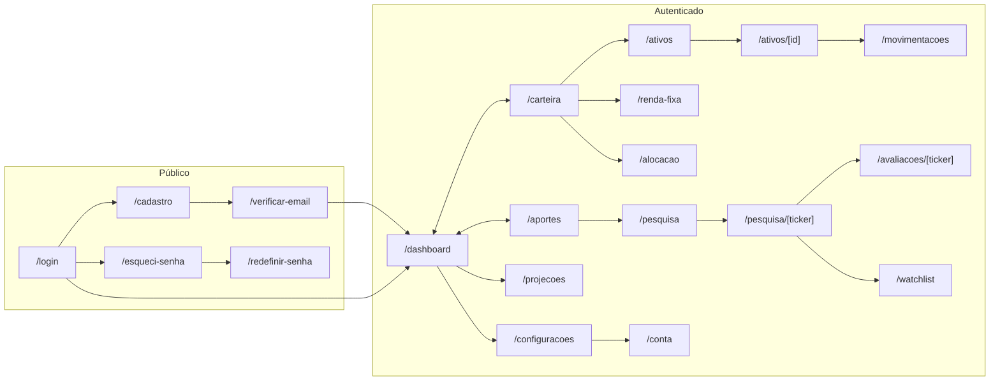

# Especificação de UI — Investment Control

> **Derivado de:** `REQUIREMENTS.md` (RN-001 a RN-088), `specs/API_CONTRACTS.md`, `specs/ERROR_CATALOG.md`.
> **Idioma:** PT-BR · **Moeda:** BRL · **Base:** web responsiva (desktop-first, utilizável em 360 px).

---

## 1. Princípios de interface

| # | Princípio | Aplicação |
|---|---|---|
| 1 | Número nunca aparece sozinho | Todo valor de mercado exibe **fonte + data de referência** (`ProvenanceBadge`) |
| 2 | Dado estimado é visualmente distinto | `ESTIMADO` usa badge âmbar e rótulo textual; nunca a mesma cor de `OFICIAL` |
| 3 | Ausência é informação | Campo sem dado mostra "Indisponível" com o motivo, nunca `0`, `-` ou vazio |
| 4 | O usuário decide | Toda sugestão tem ação explícita de aceitar, ignorar ou alterar |
| 5 | Confiança antes de densidade | Valores grandes e legíveis; detalhe em tabela expansível |
| 6 | Acessibilidade AA | Contraste ≥ 4.5:1, foco visível, navegação por teclado, rótulos associados |
| 7 | Responsivo real | Tabelas viram cartões em telas pequenas; nenhuma ação exclusiva de hover |

### 1.1 Tokens semânticos (base para o design system)

| Token | Uso |
|---|---|
| `--positive` | Ganho, dentro da meta, sucesso |
| `--negative` | Perda, acima da meta, erro de negócio |
| `--warning` | Estimado, alerta, atenção |
| `--info` | Proveniência, ajuda contextual |
| `--neutral-*` | Superfícies, texto, bordas |
| `--focus` | Anel de foco (nunca removido) |

### 1.2 Formatação

| Tipo | Formato | Exemplo |
|---|---|---|
| Dinheiro | `R$ 1.234,56` | `R$ 152.340,00` |
| Percentual | `12,5%` (1 casa padrão, 2 em detalhe) | `40,04%` |
| Quantidade | até 8 casas, sem zeros à direita | `100` · `10,5` |
| Data | `DD/MM/AAAA` | `07/11/2026` |
| Data/hora | `DD/MM/AAAA HH:mm` | `07/11/2026 18:00` |
| Nota | inteiro ou 1 casa | `78` |

---

## 2. Mapa de navegação

### 2.1 Shell da aplicação

| Região | Desktop (≥ 1024 px) | Mobile (< 768 px) |
|---|---|---|
| Navegação | Sidebar fixa com ícone + rótulo | Barra inferior com 5 itens + "Mais" |
| Cabeçalho | Patrimônio total + menu do usuário | Patrimônio total compacto + menu |
| Conteúdo | Máx. 1280 px, grid de 12 colunas | Coluna única, 16 px de margem |

Itens da navegação principal: **Dashboard**, **Carteira**, **Movimentações**, **Aportes**, **Pesquisa**. Em "Mais": Ativos, Renda fixa, Alocação, Watchlist, Projeções, Configurações, Conta.

---

## 3. Telas — autenticação

### 3.1 `/login`

| Item | Definição |
|---|---|
| Objetivo | Autenticar o titular |
| Componentes | Formulário (e-mail, senha), "Entrar", links "Criar conta" e "Esqueci minha senha" |
| Estados | Inicial · enviando (botão com spinner e `aria-busy`) · erro de credencial (alerta genérico) · erro de e-mail não verificado (alerta com ação "Reenviar verificação") |
| Validações | E-mail obrigatório e formato válido; senha obrigatória |
| RNs | RN-009, RN-067, RN-071, RN-085 |

> Mensagem de erro é sempre "E-mail ou senha inválidos" — nunca diferencia e-mail inexistente de senha errada.

### 3.2 `/cadastro`

| Item | Definição |
|---|---|
| Objetivo | Criar conta (cadastro aberto) |
| Componentes | Nome, e-mail, senha com medidor de força, confirmação, checkbox de Termos (com link e versão), checkbox de Privacidade, botão "Criar conta" desabilitado até os dois aceites |
| Estados | Inicial · enviando · e-mail já cadastrado (com link para login) · sucesso (tela de confirmação) |
| Validações | Nome 3–120; e-mail válido; senha ≥ 10 e não vazada; aceites obrigatórios |
| RNs | RN-085, RN-087 |

### 3.3 `/verificar-email`

| Item | Definição |
|---|---|
| Objetivo | Confirmar o e-mail pelo token do link |
| Componentes | Estado de processamento, sucesso com botão "Ir para o login", falha com "Reenviar link" |
| Estados | Verificando · sucesso · token inválido · token expirado · token já usado |
| RNs | RN-085, RN-086 |

### 3.4 `/esqueci-senha` e `/redefinir-senha`

| Item | Definição |
|---|---|
| Objetivo | Solicitar e concluir a redefinição de senha |
| Componentes | Campo de e-mail (solicitação) · nova senha + confirmação (redefinição) |
| Estados | Inicial · enviado (mensagem neutra, igual para e-mail existente ou não) · token inválido/expirado · sucesso |
| RNs | RN-086 |

---

## 4. `/dashboard`

| Item | Definição |
|---|---|
| Objetivo | Responder "como está meu patrimônio e o que exige atenção hoje" |
| Blocos | (1) Cards de resumo; (2) Comparação com meta 50/50; (3) Gráfico de evolução; (4) Rendimentos do mês; (5) Painel de oportunidades; (6) Alertas |
| Cards | Patrimônio total, Total investido, Valor atual, Resultado acumulado, Renda mensal, Rendimentos no ano, % RF, % FII |
| Comparação 50/50 | Barra de alocação com marca da meta e rótulo textual ("Renda fixa 40,0% · meta 50,0% · −10,0 p.p.") |
| Gráficos | Evolução patrimonial (linha, 12 meses), Distribuição por classe (donut), Distribuição por segmento (barras) |
| Painel de oportunidades | Classes e segmentos abaixo da meta, ativos da watchlist, fundos com alerta, sugestão do aporte do mês |
| Estados | Carregando (skeleton) · vazio (primeiro acesso com CTA "Cadastre seu primeiro ativo") · erro parcial (bloco isolado com "Tentar novamente") · completo |
| RNs | RN-020, RN-061, RN-062, RN-063 |

> Nenhum número de mercado no dashboard aparece sem `ProvenanceBadge` no tooltip ou na legenda do card.

---

## 5. `/carteira`

| Item | Definição |
|---|---|
| Objetivo | Detalhar posições por ativo, classe e segmento |
| Componentes | Filtros (classe, segmento, status), tabela de posições, resumo por classe/segmento, ações "Nova movimentação" e "Exportar" (se aprovado — `PEND-015`) |
| Colunas da tabela | Ticker · Nome · Segmento · Quantidade · Preço médio · Preço atual (com data) · Valor atual · % carteira · Resultado · Ações |
| Mobile | Cartões com ticker, valor atual e resultado; detalhe ao tocar |
| Estados | Carregando · vazio · sem cotação (coluna "Preço atual" mostra "Indisponível" + motivo) · erro |
| RNs | RN-015, RN-020, RN-023, RN-038, RN-091 |

> Sem cotação, a posição entra pelo custo de aquisição e a linha recebe a marca "valor indisponível" — o patrimônio não cai artificialmente e o número não é confundido com mercado (RN-091).

---

## 6. Ativos

### 6.1 `/ativos`

Lista com busca por ticker/nome, filtro de classe/segmento/status e ação "Novo ativo". Colunas: Ticker, Nome, Classe, Segmento, Status, Posição, Ações. Estado vazio orienta o cadastro. (RN-010 a RN-013)

### 6.2 `/ativos/novo`

| Campo | Componente | Validação |
|---|---|---|
| Ticker | texto com máscara maiúscula | obrigatório, 4–20 alfanuméricos, único |
| Nome | texto | obrigatório, 3–160 |
| Classe | select | obrigatório |
| Segmento | select dependente | obrigatório quando classe = FII; desabilitado com explicação para renda fixa |
| CNPJ | texto com máscara | opcional, DV válido |
| Administrador / Gestor | texto | opcionais |
| Fonte dos dados | select de provedores | opcional |
| Status | select | default "Ativo" |
| Observações | textarea | ≤ 1000 |

Ações: "Salvar" (primária) e "Cancelar". Erros do catálogo mapeados por campo.

### 6.3 `/ativos/[id]`

Abas: **Visão geral** (dados cadastrais + posição), **Movimentações** (histórico do ativo), **Rendimentos**, **Histórico de preços** (gráfico com proveniência), **Ficha externa** (link para `/pesquisa/[ticker]`). Ação "Editar" respeita campos imutáveis (RN-015).

---

## 7. `/movimentacoes`

| Item | Definição |
|---|---|
| Objetivo | Registrar e consultar o histórico que origina a posição |
| Lista | Filtros (ativo, tipo, período), tabela paginada, ação "Nova movimentação" |
| Formulário (drawer/modal) | Ativo (busca), Tipo (segmented), Data, Quantidade, Valor unitário, Custos, Valor total (calculado e editável), Observações |
| Cálculo em tempo real | Mostra `quantidade × unitário + custos` e sinaliza divergência acima de R$ 0,01 antes de salvar |
| Confirmação de posição negativa | Diálogo com o impacto (posição atual, solicitada, resultante) e campo de motivo obrigatório |
| Cancelamento | Ação "Cancelar movimentação" com motivo; item permanece visível como cancelado |
| Estados | Carregando · vazio · erro de validação por campo · conflito de posição negativa · sucesso |
| RNs | RN-014 a RN-019, RN-084 |

---

## 8. `/renda-fixa`

| Item | Definição |
|---|---|
| Objetivo | Controlar títulos, saldos, vencimentos e liquidez |
| Lista | Tabela: Instituição · Produto · Indexador · Taxa · Aplicação · Vencimento · Saldo · Status do saldo · Liquidez · Alerta |
| Formulário | Campos de RN-057 com selects de produto/indexador/liquidez; cálculo de cobertura FGC conforme produto |
| Alertas | Faixa superior com contadores por severidade; filtro "Somente com alerta" |
| Estados | Carregando · vazio · saldo estimado (badge âmbar) · erro |
| RNs | RN-057 a RN-059, RN-058 |

---

## 9. `/alocacao`

| Item | Definição |
|---|---|
| Objetivo | Configurar metas e visualizar desvios |
| Seções | (1) Metas por classe com soma em tempo real; (2) Metas por segmento com soma em tempo real; (3) Tabela de desvios |
| Validação | Botão "Salvar" desabilitado enquanto a soma do escopo ≠ 100%; mensagem "Faltam 5,0 p.p." ou "Excede 2,5 p.p." |
| Tabela de desvios | Referência · Atual · Meta · Desvio (p.p.) · Valor para meta · Situação (badge abaixo/acima/dentro) |
| Estados | Carregando · sem configuração (formulário em branco com defaults) · erro de soma |
| RNs | RN-021 a RN-024, RN-082 |

---

## 10. `/aportes`

| Item | Definição |
|---|---|
| Objetivo | Responder "onde coloco os próximos R$ 1.000" |
| Entrada | Campo de valor disponível + atalhos R$ 500 / 1.000 / 1.500 / 2.000 |
| Resultado | Distribuição sugerida por classe e segmento, ativos para estudar, justificativa por linha, alertas aplicáveis |
| Ações | "Aceitar", "Ignorar", "Alterar" — cada uma registra a decisão |
| Simulador | Comparativo antes/depois com barras; nenhum valor é aplicado à carteira |
| Estados | Carregando (cálculo) · sem metas (CTA para `/alocacao`) · dados insuficientes · resultado |
| RNs | RN-025 a RN-028, RN-050 a RN-056, RN-076, RN-078 |

> A tela nunca exibe "recomendação de compra": o rótulo é "sugestão de distribuição" e "ativos que podem ser estudados".

---

## 11. `/pesquisa` e `/pesquisa/[ticker]`

### 11.1 Busca

Campo único com debounce de 400 ms, busca por ticker ou nome, resultados com ticker, nome, classe e segmento. Funciona sem o ativo estar cadastrado (RN-029). Estado vazio diferencia "nada encontrado" de "provedor indisponível".

### 11.2 Ficha do FII

| Bloco | Conteúdo |
|---|---|
| Identificação | Ticker, nome, CNPJ, segmento, administrador, gestor, início |
| Indicadores | Preço, VPC, P/VP, PL, cotistas, DY 12 m, dividendos por cota |
| Riscos e características | Vacância física/financeira, concentração (imóveis, inquilinos, região), alavancagem, qualidade dos recebíveis, inadimplência, prazos/indexadores |
| Histórico | Preços, dividendos, PL, P/VP (gráficos) |

Cada bloco e cada valor exibem `ProvenanceBadge` (fonte + data). Valores indisponíveis aparecem como "Indisponível" com tooltip explicando o campo ausente. Ação "Atualizar dados" dispara `POST /api/pesquisa/{ticker}/atualizar`.

**RNs:** RN-029 a RN-038.

---

## 12. `/avaliacoes/[ticker]` e `/watchlist` — Fase 4

### 12.1 Avaliação

| Item | Definição |
|---|---|
| Objetivo | Comparar FIIs por critérios explícitos |
| Componentes | Nota 0–100 em destaque; tabela de critérios com status (atendido / não atendido / indisponível) e peso; justificativa; data da análise; ações "Adicionar à watchlist" e "Recalcular" |
| Regra visual | Critério indisponível usa badge neutro e **não** soma pontos; nota nunca é exibida cheia com dado faltante (RN-042) |
| RNs | RN-039 a RN-047 |

### 12.2 Watchlist

Tabela com ticker, data de inclusão, motivo, preço de referência, P/VP, nota e status (chips de estudar/acompanhar/aprovado/descartado). Ação de mudança de status inline. (RN-048)

---

## 13. `/projecoes` — Fase 5

| Item | Definição |
|---|---|
| Entrada | Patrimônio inicial (preenchido com a carteira atual), aporte mensal, prazo, inflação, retorno real, reinvestimento |
| Saída | Tabela e gráfico por cenário (conservador/moderado/otimista); colunas nominal e real; comparação 5/10/15/20 anos |
| Aviso permanente | Faixa informativa: "Projeção não é garantia de rentabilidade. Retorno real ≠ distribuição de rendimentos." |
| RNs | RN-064 a RN-066, RN-080, RN-081 |

---

## 14. `/configuracoes` e `/conta`

### 14.1 Configurações

Seções: **Critérios e pesos** (soma = 100 em tempo real), **Limites de concentração**, **Provedores** (capacidades, limite, custo, prioridade), **Termos e privacidade** (versões vigentes). Salvar exige confirmação quando altera cálculo já usado em avaliação.

### 14.2 Conta

Dados do titular (nome, e-mail), troca de senha, encerramento de conta com confirmação por senha e texto explicando a anonimização irreversível (RN-088).

---

## 15. Componentes transversais

| Componente | Responsabilidade | Regras |
|---|---|---|
| `ProvenanceBadge` | Exibir fonte + data de referência + status do dado | Obrigatório em todo valor de mercado; clicável abre detalhe da coleta |
| `MoneyValue` | Renderizar decimal como BRL | Recebe string decimal; nunca faz cálculo no cliente |
| `PercentValue` | Percentual com sinal e casas configuráveis | Sinal explícito para desvio |
| `AllocationBar` | Barra atual × meta | Rótulo textual além da cor (acessibilidade) |
| `StatusBadge` | Status de dado, alerta e situação | Sempre com texto, nunca só cor |
| `DataTable` | Tabela paginada e ordenável | Vira cartões em < 768 px; `aria-sort` |
| `EmptyState` | Ausência com explicação e CTA | Diferencia "vazio" de "indisponível" |
| `ErrorState` | Erro com ação de retry | Mostra `traceId` discretamente |
| `ConfirmDialog` | Ação destrutiva ou de impacto | Foco preso, ESC fecha, ação primária explícita |
| `MoneyInput` | Entrada monetária | Máscara BRL, aceita vírgula, devolve string decimal |

---

## 16. Validação de formulários

| Regra | Comportamento |
|---|---|
| Validação no blur e no submit | Nunca validar a cada tecla (exceto soma de metas, que é em tempo real) |
| Mensagem por campo | Texto abaixo do campo, associado por `aria-describedby` |
| Erro de servidor | Mapeado por `details.errors[].field`; foco no primeiro campo inválido |
| Preservação | Dados digitados nunca são perdidos em erro 422 |
| Botão | Desabilitado apenas quando a regra é estrutural (ex.: soma ≠ 100); nunca escondido |
| Confirmação | Exigida para: posição negativa, cancelamento de movimentação, exclusão de conta, alteração de metas em uso |

---

## 17. Estados de tela

| Estado | Regra |
|---|---|
| Carregando | Skeleton com o mesmo layout do conteúdo; nunca spinner de página inteira após o primeiro carregamento |
| Vazio | Explica o que falta e oferece a ação principal |
| Parcial | Bloco afetado mostra "Dados indisponíveis" + fonte; o restante permanece utilizável (RN-073) |
| Erro | Mensagem amigável + tentar novamente + `traceId` |
| Sucesso | Feedback efêmero (toast) para ação rápida; confirmação persistente para mudança de configuração |

---

## 18. Acessibilidade

- Contraste mínimo 4.5:1 para texto e 3:1 para elementos gráficos.
- Foco visível em todos os interativos; ordem de tabulação segue o layout.
- Gráficos têm tabela equivalente acessível.
- Não usar cor como único portador de significado (situação, status, alerta sempre com texto).
- Formulários com `label` associado, `aria-invalid`, `aria-describedby`.
- Diálogos com `role="dialog"`, foco inicial definido e retorno de foco ao fechar.

---

## 19. Responsividade

| Faixa | Comportamento |
|---|---|
| ≥ 1280 px | Sidebar fixa, grid de 12 colunas, tabelas completas |
| 768–1279 px | Sidebar colapsável em ícones, grid de 8 colunas |
| < 768 px | Barra inferior, coluna única, tabelas em cartões, ações em menu |

---

## 20. Microcopy

| Situação | Texto padrão |
|---|---|
| Dado estimado | "Estimado — não é valor oficial" |
| Sem cotação | "Cotação indisponível. Última referência: DD/MM/AAAA" |
| Sem dado suficiente | "Dados insuficientes para avaliar este critério" |
| Sugestão | "Sugestão de distribuição — a decisão é sua" |
| Projeção | "Projeção não é garantia de rentabilidade" |
| Erro genérico | "Algo deu errado. Tente novamente em instantes." |

---

## 21. Matriz tela → RN

| Tela | RNs principais |
|---|---|
| `/login`, `/cadastro`, `/verificar-email`, `/esqueci-senha`, `/redefinir-senha` | RN-009, RN-067, RN-071, RN-085 a RN-088 |
| `/dashboard` | RN-020, RN-061 a RN-063 |
| `/carteira` | RN-015, RN-020, RN-023, RN-038 |
| `/ativos` | RN-010 a RN-013 |
| `/movimentacoes` | RN-014 a RN-019, RN-084 |
| `/renda-fixa` | RN-057 a RN-059 |
| `/alocacao` | RN-021 a RN-024, RN-082 |
| `/aportes` | RN-025 a RN-028, RN-050 a RN-056 |
| `/pesquisa` | RN-029 a RN-038 |
| `/avaliacoes/[ticker]` | RN-039 a RN-047 |
| `/watchlist` | RN-048 |
| `/projecoes` | RN-064 a RN-066, RN-080, RN-081 |
| `/configuracoes` | RN-034, RN-049, RN-082 |
| `/conta` | RN-088 |
